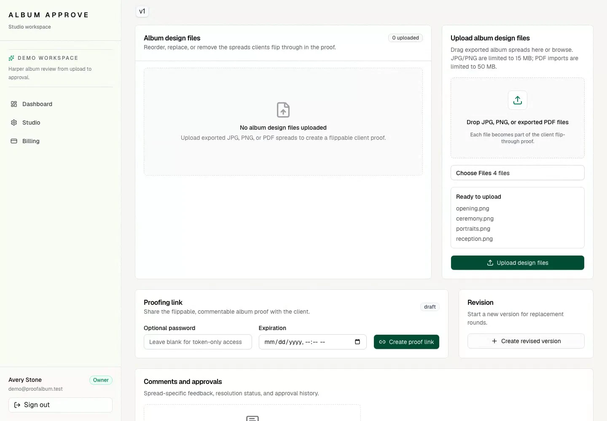
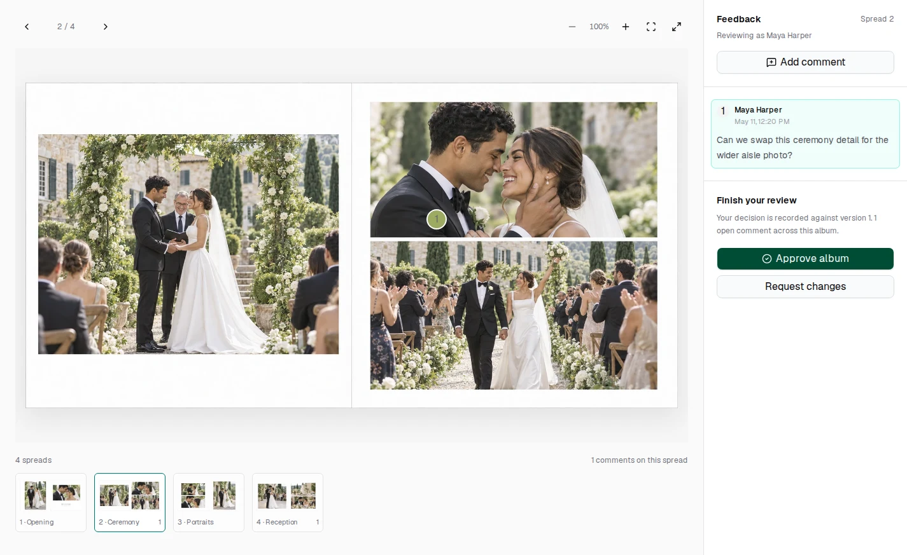
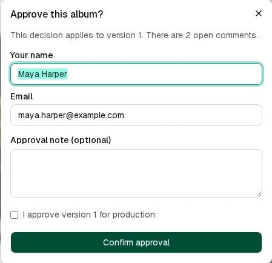

# Album Approve

Album Approve is a full-stack album proofing app for wedding and portrait photographers. Studios can upload exported album spreads, share a private flip-through proof with clients, collect pinned spread-level comments, manage revisions, export feedback, and record final approval before an album goes to print.

## TLDR

Upload spreads. Collect pinned feedback. Record approval of a specific album version. Built with Next.js, React, TypeScript, and Cloudflare Workers, with repeatable demo data, automated browser checks, and documented production gaps.

[Live preview](https://album-approve.hangi87.workers.dev) | [Watch the workflow](https://album-approve.hangi87.workers.dev/#workflow) | [Try the client proof](https://album-approve.hangi87.workers.dev/proof/demo-proof-token)

> **Hosted preview: non-durable storage.** The Worker uses `PROOFALBUM_STORAGE=memory`. Projects, uploads, comments, and approvals live only in the serving isolate and can disappear when it is recycled or redeployed. Separate isolates do not share this state. Use fictional files, not real client work; this is not a production storage or approval archive.

## Workflow Demo

[](https://album-approve.hangi87.workers.dev/#workflow)

The 24-second recording shows the real app, not an animated mockup:

1. Upload four exported wedding album spreads in the studio workspace.
2. Open the client proof and save a pinned comment on the ceremony spread.
3. After the studio resolves the note, confirm approval of version one and see the saved confirmation.

The desktop recording stays in use on every screen size. Chapter navigation, pause, replay, and native fullscreen are available. Playback is deferred until visible; reduced-motion and data-saving visitors choose when to play. The studio's comment-resolution handoff is omitted between scenes. [Open the MP4 directly](https://album-approve.hangi87.workers.dev/product/workflow-demo-desktop.mp4).

<details>
<summary>See the feedback and approval screens</summary>

**Feedback:** a numbered pin connects the client's requested change to the exact spread location.



**Approval:** the confirmation identifies the version and asks for an explicit production decision. This screenshot shows the confirmation dialog, not a completed approval.



</details>

The four sample wedding spreads use generated imagery of fictional people. The screenshots are actual app captures, not customer endorsements. See [sample asset provenance](docs/sample-assets.md) and [video recording and browser-check instructions](docs/marketing-assets.md).

## About

Album Approve is built around a narrow studio workflow: proof wedding albums with clients before production. The app intentionally separates the client proofing surface from the studio dashboard, keeps guest access scoped to share links, and isolates database, storage, billing, and email integrations behind server modules.

Core user flows:

- Studio dashboard for projects, versions, uploads, proof links, billing state, CSV export, and comment resolution.
- Client proofing portal with signed links, optional password protection, responsive spread review, zoom, keyboard navigation, click-to-pin comments, and approval/change-request decisions.
- Seeded preview data and assets for repeatable local review and automated tests.

## Tech Stack

- **Framework:** Next.js 16 App Router, React 19, TypeScript.
- **UI:** Tailwind CSS, shadcn/ui-style primitives, Radix UI, lucide-react icons.
- **Validation:** Zod schemas for server actions and proofing forms.
- **Persistence:** Local JSON store under `.data`; isolate-local memory for the hosted preview. Supabase Postgres migration and readiness boundary exist, but application persistence is not wired to Supabase.
- **Storage:** Local files or in-memory buffers behind signed asset URLs. Fictional sample assets and the workflow video use public static delivery. Durable private object storage remains a production target.
- **Payments:** Stripe Checkout and webhook integration with safe local fallbacks when Stripe env vars are missing.
- **Email:** Resend-ready email boundary with local notification logging when credentials are absent.
- **Testing:** Vitest plus Playwright browser scripts for proof-token scoping, comments/approvals, replacement behavior, signed assets, CSV export, and workflow playback.

## Engineering Highlights

- **Secure share links:** Proof tokens are generated with cryptographic randomness and stored as HMAC hashes, so newly created tokens are only revealed once.
- **Private asset access:** Uploaded spreads are served through `/api/assets/[...key]` only when an expiring HMAC signature matches the storage key; fictional sample spreads are public.
- **Separated studio and guest access:** Dashboard routes use a signed HTTP-only session cookie, while proofing access is scoped to share tokens and optional token-bound proof cookies.
- **Versioned approval model:** Comments and approval events attach to album versions; each decision records its reviewer and timestamp.
- **Upload validation:** JPG, PNG, and PDF imports validate MIME type, extension, size, storage key safety, and image dimensions before becoming proofable spreads.
- **Replacement fixes:** JPG/PNG replacements use unique private storage keys and update dimensions without changing the spread ID or its comment links. The UI navigates to the updated spread after saving and shows success; failed storage writes do not report a successful save.
- **Browser regression checks:** Portrait and wide replacement images retain their proportions and signed delivery; unsigned replacement URLs return 403. Workflow chapters decode distinct frames at desktop and phone widths, with keyboard, playback, reduced-motion, and failure-state checks.
- **External service boundaries:** Stripe, Resend, Supabase, and storage integration points are isolated behind server modules so the preview can run locally without production credentials.
- **Repeatable preview path:** `npm run seed` resets the local app to a known wedding album with spreads, comments, proof link, billing state, and email activity.

## Architecture

The app is a server-rendered Next.js application with client components for rich review interactions. Mutations flow through Server Actions, data access is centralized in `src/server/store.ts`, and asset access is mediated through signed route handlers.

- Architecture overview and C4-style container diagram: [docs/architecture.md](docs/architecture.md)
- Architecture decision records: [docs/adrs/README.md](docs/adrs/README.md)
- Deployment notes: [docs/deployment.md](docs/deployment.md)
- Security notes: [docs/security.md](docs/security.md)

## Project Structure

```text
src/app/                 Next.js routes, Server Actions, and API route handlers
src/components/          Proofing UI, dashboard UI, and shared primitives
src/server/              Auth, store, storage, billing, email, security, schemas
src/lib/                 Formatting and utility helpers
scripts/                 Demo seed, asset optimization, and browser review
assets/demo/             Original generated wedding album spreads
public/product/          Product screenshots, workflow recordings, posters, captions
supabase/migrations/     Initial Postgres schema and RLS starter policies
docs/                    Architecture, ADRs, deployment, and security notes
```

## Local Setup

```bash
npm ci
cp .env.example .env.local
npm run seed
npm run dev
```

Open `http://localhost:3000`, sign in with `demo@proofalbum.test`, and open the sample proof link from the project page.

Useful commands:

```bash
npm run format
npm run lint
npm run typecheck
npm test
npm run build
```

### Browser Checks

| Script                                  | Coverage                                                                                                                                                                            | Runtime                                                                                                            |
| --------------------------------------- | ----------------------------------------------------------------------------------------------------------------------------------------------------------------------------------- | ------------------------------------------------------------------------------------------------------------------ |
| `node scripts/verify-album-visuals.mjs` | Fullscreen/zoom/focus, pinned comments, approval confirmation, replacement save feedback, portrait/wide replacements, signed asset rejection, responsive layouts                    | Starts its own production server on `127.0.0.1:4317` after a build; regenerates screenshots and the capture report |
| `node scripts/verify-marketing.mjs`     | Desktop video chapters at 1440/768/390/320px, decoded frames, pause/replay, keyboard tabs, deferred autoplay, reduced motion, Save Data, load failure, pricing, and demo activation | Uses an already running local server; `BASE_URL` defaults to `http://localhost:3000`                               |

Both scripts require Playwright and a browser installation; `PLAYWRIGHT_MODULE` can point to an existing installation and `BROWSER_CHANNEL=chrome` can select installed Chrome. They submit real mutations to disposable local data. Use `PROOFALBUM_STORAGE=memory`, never a real client dataset, and restart the server afterward. Setup details and the dated screenshot report are in [sample assets](docs/sample-assets.md) and [marketing assets](docs/marketing-assets.md). The report is capture-time evidence, not a claim that every later commit has passed.

## Environment Variables

See `.env.example`. The local development preview runs without external credentials. Environment values alone do not enable production persistence or identity: implement and validate those adapters before accepting real client work.

Important variables:

- `NEXT_PUBLIC_APP_URL`
- `PROOFALBUM_SECRET`
- `PROOFALBUM_STORAGE` (unset for local filesystem storage; `memory` for disposable previews)
- `NEXT_PUBLIC_SUPABASE_URL`
- `SUPABASE_SERVICE_ROLE_KEY`
- `STRIPE_SECRET_KEY`
- `STRIPE_WEBHOOK_SECRET`
- `RESEND_API_KEY`
- `EMAIL_FROM`

## Database And Storage

The initial Postgres schema is in `supabase/migrations/0001_initial_schema.sql`. It includes studios, studio members, clients, projects, album versions, spreads, share links, comments, approvals, and subscriptions, plus starter RLS policies.

Local preview uploads are written under `.data/uploads` and served only through signed asset URLs. JPG and PNG dimensions are extracted during upload. PDF imports are stored privately and converted into reviewable placeholder spreads per detected page. For production, replace local storage calls in `src/server/storage.ts` with Supabase Storage or S3-compatible private object storage and a real PDF page renderer.

Hosted memory mode stores application data and uploaded bytes in `globalThis` state, not a database, R2, or persistent disk. A successful save is not a durable-save guarantee. The bundled public sample images and workflow video survive deployments because they are shipped static assets; uploaded files do not.

## Stripe And Email

Set `STRIPE_SECRET_KEY`, `STRIPE_WEBHOOK_SECRET`, and the plan price IDs to enable real Stripe Checkout sessions and webhook subscription updates. When Stripe is not configured, checkout returns to the billing page in preview mode so the app remains usable.

Set `RESEND_API_KEY` and `EMAIL_FROM` to send proofing emails. Without credentials, email events are recorded in the local preview store so notification behavior remains visible.

## Deployment

The current live preview deploys to Cloudflare Workers with the OpenNext Cloudflare adapter. Cloudflare Pages is best suited to static Next.js exports; this app uses Server Actions and route handlers, so the hosted preview uses Cloudflare's full-stack Next.js Workers path.

```bash
npm run deploy:cf
```

The production target remains Supabase Postgres for relational data, private object storage for spreads, Stripe for subscriptions, and Resend for transactional email.

The current deployment is a disposable preview. Creating a Supabase project or setting its keys does **not** replace the JSON/memory store; implement database-backed reads/writes and durable private storage first, then configure production identity and test studio isolation. The steps below configure external services, not a complete production rollout.

1. Create the Supabase project and run `supabase/migrations/0001_initial_schema.sql`.
2. Create a private storage bucket for album spreads.
3. Configure Stripe products and webhook URL `/api/stripe/webhook`.
4. Configure Resend sender/domain verification.
5. Set production env vars in Cloudflare.
6. Deploy with `npm run deploy:cf`.

More detail is in [docs/deployment.md](docs/deployment.md).

## Security And Privacy Notes

The fictional demo spreads and product screenshots are intentionally public; real uploaded spreads use signed private routes.

- Share tokens are random and stored as HMAC hashes.
- Proof link passwords are stored with scrypt hashes.
- Uploaded files use signed asset routes, not public sample URLs.
- Assets require expiring signatures.
- Dashboard access is separate from guest proofing access.
- Approval events store timestamps and optional IP hashes.
- Production should add rate limits to guest password attempts, comments, and approval submissions.

More detail is in [docs/security.md](docs/security.md).

## Limitations And Future Work

- Replace the local JSON preview store with Supabase queries and generated database types.
- Move large uploads to direct-to-storage uploads instead of Server Action request bodies.
- Replace PDF placeholder previews with rendered page images.
- Add team members, studio roles, and richer usage gates.
- Add transactional email templates and webhook-driven subscription status sync.
- Add a production onboarding/request-access flow before charging real studios.
