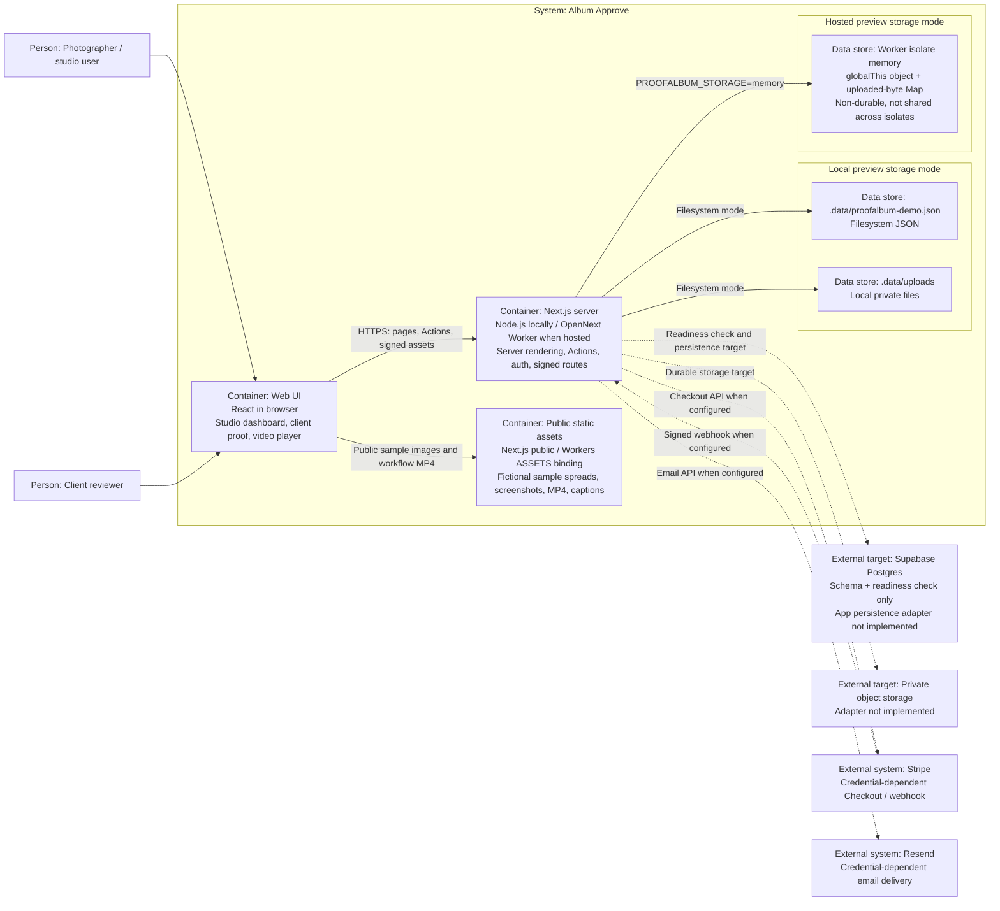

# Architecture

Album Approve is a Next.js App Router application for album proofing. It keeps the local preview self-contained while preserving production boundaries for data, storage, billing, and email.

## Overview

The app has two main surfaces:

- **Studio dashboard:** authenticated routes for projects, clients, versions, spread upload management, proof link creation, comment resolution, CSV export, billing, and settings.
- **Client proofing portal:** token-scoped routes for album review, pinned spread comments, optional password unlock, and approval or change-request submission.

Server Actions handle most mutations. Route handlers cover signed asset delivery, Stripe checkout/webhooks, and CSV export. Shared server modules own validation, persistence, storage, security, billing, and email boundaries.

## C4-Style Container Diagram

This container view separates the browser, server runtime, data stores, and external systems. Dashboard/proof components and server modules are responsibilities inside the Next.js container, not independently deployed services. Solid connections describe current paths; dashed connections are credential-dependent integrations or unimplemented persistence targets.

## Runtime Flow

### Studio Workflow

1. A studio user signs in through the local demo session flow.
2. Dashboard routes call `getCurrentUser()` before rendering protected project data.
3. Project, version, upload, link, comment-resolution, and archive mutations run through Server Actions in `src/app/actions/dashboard.ts`.
4. Server Actions validate form input with Zod schemas in `src/server/schema.ts`, then call store functions in `src/server/store.ts`.
5. Uploads are validated in `src/server/storage.ts`, written to private local storage, and represented as spreads on an album version.
6. Proof links generate random tokens, store HMAC token hashes, and reveal the raw token only in the creation redirect.

JPG/PNG replacements keep the spread ID and its comments, allocate a unique storage key, and refresh the file dimensions. `replaceSpreadAction` returns a fresh project destination only after saving; the client navigates there to show the new image and save status. This avoids returning a revalidated page inside the replacement response. Browser checks exercise portrait and wide replacements and reject their unsigned URLs.

### Client Proofing Workflow

1. A reviewer opens `/proof/[token]`.
2. The server resolves the HMAC token hash and checks optional password or proof-access cookie state.
3. The proofing page receives signed URLs for each spread and renders the interactive `ProofViewer` client component.
4. Client comments submit through `addProofCommentAction`, which verifies token scope before appending comments to the version.
5. Approval or change-request decisions submit through `submitProofDecisionAction`, which records an append-only approval event and updates version status.

### Asset Access Flow

1. Spread URLs are generated with an expiring HMAC signature.
2. `/api/assets/[...key]` rejects missing, expired, or mismatched signatures.
3. Valid requests read the private asset from local files or the memory-mode buffer map and return it with private cache headers.
4. Storage keys are normalized to reject path traversal before filesystem access.

Allowlisted fictional sample spreads and the workflow recording are public static assets, not private uploads. Replacing a sample spread creates a private upload; it must not inherit public sample delivery.

### Workflow Video

`WorkflowPreview` serves the desktop recording, poster, and caption track from `public/product`, using the chapter timings in `src/lib/workflow-demo-assets.json`. It loads the MP4 only on visibility or explicit play, pauses offscreen, and respects reduced-motion/data-saving preferences. A failed load retains a poster and a link to the interactive proof. Recording scripts submit actual uploads, comments, resolution, and approval only to a local fictional workspace; watching the video does not mutate a proof.

## Deployment Shape

The current repository supports a local demo and a production target:

- **Local preview:** JSON persistence and local file storage under `.data`, with seeded sample assets and safe Stripe/email fallback behavior.
- **Hosted preview:** Cloudflare Workers with OpenNext, static asset binding, Node.js compatibility, and non-durable in-memory preview storage.
- **Production target:** Supabase Postgres for relational data, private object storage for spreads, Stripe for subscriptions, and Resend for transactional email.

`src/server/repository.ts` exposes a Supabase readiness check. It does not route store reads/writes to Supabase, and adding credentials does not turn the preview into a persistent application. Production identity, persistence, and storage require implementation, not just configuration. See [ADR 0005](adrs/0005-workers-disposable-hosted-preview.md).

## Key Constraints

- The local JSON store is intentionally simple and not a concurrent production database.
- Hosted state and uploaded bytes live only within a Worker isolate, can disappear on recycling/redeployment, and are not shared across isolates. A saved comment or approval is not a durable record. Do not upload real client work to this preview.
- Large uploads should eventually move to direct-to-storage uploads instead of passing through Server Action request bodies.
- PDF imports currently create placeholder review spreads from detected page counts; production should render actual PDF pages.
- The demo auth flow is not a production identity provider. Production should use Supabase Auth, Clerk, or an equivalent auth system and enforce studio membership on every mutation.
- Guest proofing actions need rate limits before production traffic.
